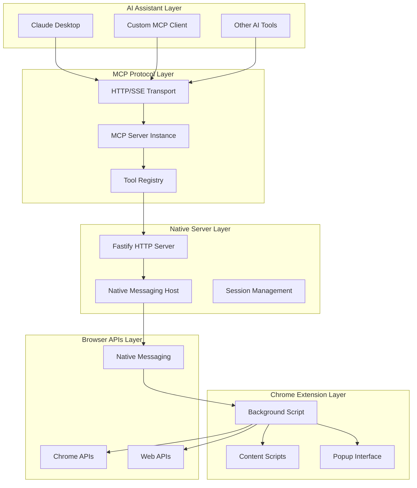

# Chrome MCP Server Architecture 🏗️

This document provides a detailed technical overview of the Chrome MCP Server architecture, design decisions, and implementation details.

## 📋 Table of Contents

- [Overview](#overview)
- [System Architecture](#system-architecture)
- [Component Details](#component-details)
- [Data Flow](#data-flow)
- [Security Considerations](#security-considerations)

## 🎯 Overview

Chrome MCP Server is a sophisticated browser automation platform that bridges AI assistants with Chrome browser capabilities through the Model Context Protocol (MCP). The architecture is designed for:

- **High Performance**: Efficient native messaging
- **Extensibility**: Modular tool system for easy feature additions
- **Reliability**: Robust error handling and graceful degradation
- **Security**: Sandboxed execution and permission-based access control

## 🏗️ System Architecture



## 🔧 Component Details

### 1. Native Server (`app/native-server/`)

**Purpose**: MCP protocol implementation and native messaging bridge

**Key Components**:

- **Fastify HTTP Server**: Handles MCP protocol over HTTP/SSE
- **Native Messaging Host**: Communicates with Chrome extension
- **Session Management**: Manages multiple MCP client sessions
- **Tool Registry**: Routes tool calls to Chrome extension

**Technologies**:

- TypeScript + Fastify
- MCP SDK (@modelcontextprotocol/sdk)
- Native messaging protocol

### 2. Chrome Extension (`app/chrome-extension/`)

**Purpose**: Browser automation and content extraction

**Key Components**:

- **Background Script**: Main orchestrator and tool executor
- **Content Scripts**: Page interaction and content extraction
- **Popup Interface**: User configuration and status display

**Technologies**:

- WXT Framework + Vue 3
- Chrome Extension APIs

### 3. Shared Packages (`packages/`)

#### 3.1 Shared Types (`packages/shared/`)

- Tool schemas and type definitions
- Common interfaces and utilities
- MCP protocol types

## 🔄 Data Flow

### Tool Execution Flow

```
┌─────────────┐    ┌──────────────┐    ┌─────────────────┐    ┌──────────────┐
│ AI Assistant│    │ Native Server│    │ Chrome Extension│    │ Browser APIs │
└─────┬───────┘    └──────┬───────┘    └─────────┬───────┘    └──────┬───────┘
      │                   │                      │                   │
      │ 1. Tool Call      │                      │                   │
      ├──────────────────►│                      │                   │
      │                   │ 2. Native Message   │                   │
      │                   ├─────────────────────►│                   │
      │                   │                      │ 3. Execute Tool   │
      │                   │                      ├──────────────────►│
      │                   │                      │ 4. API Response   │
      │                   │                      │◄──────────────────┤
      │                   │ 5. Tool Result      │                   │
      │                   │◄─────────────────────┤                   │
      │ 6. MCP Response   │                      │                   │
      │◄──────────────────┤                      │                   │
```

## 🔧 Extension Points

### Adding New Tools

1. **Define Schema** in `packages/shared/src/tools.ts`
2. **Implement Tool** extending `BaseBrowserToolExecutor`
3. **Register Tool** in tool index
4. **Add Tests** for functionality

### Protocol Extensions

1. **MCP Extensions** for custom capabilities
2. **Transport Layers** for different communication methods
3. **Authentication** for secure connections
4. **Monitoring** for performance metrics

This architecture enables Chrome MCP Server to deliver high-performance browser automation while maintaining security and extensibility.
